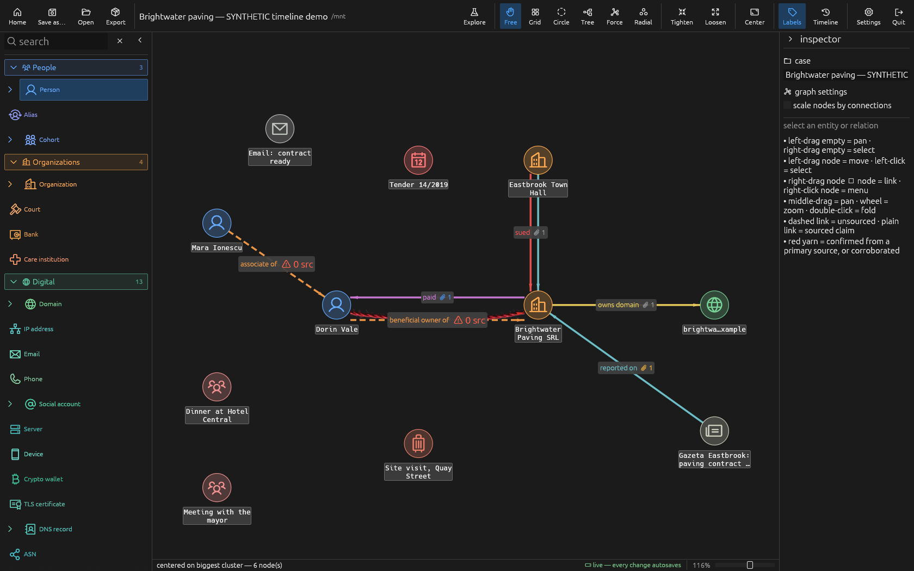
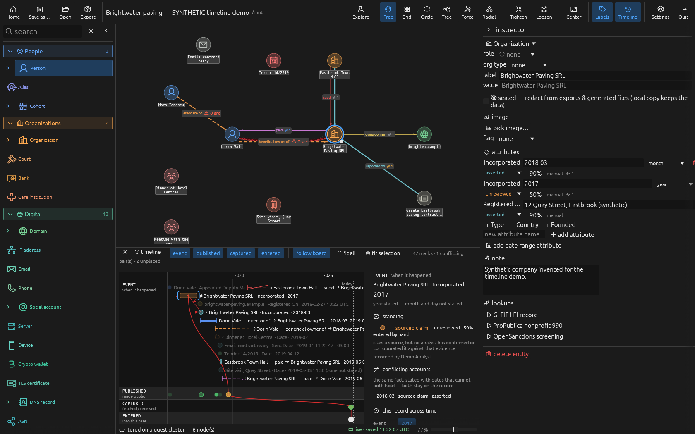

# Red String

`redstring` is a desktop tool for investigative link analysis. A case is a graph
of entities and typed relations; every relation and fact carries its own sources
and provenance. Cases are directories of plain-text files, designed to be
versioned and shared with Git.

Rust, egui/wgpu, local only — no server, no account.

> **Status:** development preview, v0.0.1. Linux only, single user so far, no
> external review, no releases. The case format (version 1) may still change.



## Model

- **Entity** — 62 kinds (person, organisation, domain, account, document, event, …).
  Optional portrait/logo image or bundled country flag.
- **Relation** — typed, directed; 147 verbs in 22 families. Holds sources, origin,
  status, confidence, author, entry time and an optional validity window.
- **Observation** — a typed fact on an entity, sourced and stamped individually.
- **Source** — kind, reference (URL/file/note), excerpt, publication date, capture
  time, `sha256` of captured content, credibility tier, originating organisation,
  archive snapshots.

Provenance on every record: origin (`manual`, `lookup`, `import`, `inference`),
status, confidence, author, time of entry.

**Status checking.** `confirmed · primary` requires a source rated `primary`;
`corroborated` requires two or more independent origins. Relation statuses the
attached sources cannot support are greyed out in the inspector; `--check` reports
any relation or observation whose status outruns its sources as `OVERCLAIMED`. Relations with no source are drawn dashed with a `0 src` warning.

**Sealed records.** Any entity, observation, source or relation can be sealed.
Sealed data stays in the working case and is removed from every derived and
exported file (see below).

## Git collaboration

The case format is built for Git: plain text, one record per line, stable file
layout, so changes diff, review and merge like code.

```
case/
├── case.redstring            # metadata
├── display.ron               # positions, camera, layout
├── relations.ndjson          # one relation per line
└── entities/<slug>/
    ├── entity.ron
    ├── observations.ndjson   # one fact per line
    └── note.md
```

- Records are stamped with `git config user.name` / `user.email`, read when
  `redstring` starts (repository-local config applies when started inside the case).
- Changes written to disk while a case is open — `git pull`, `git checkout`, a
  script, another tool — are merged into the open case against the last synced
  state. Non-overlapping changes are absorbed; if both sides changed the same
  record, a conflict window offers *keep mine* / *take theirs*.
- Writes are atomic per file and serialised by a `.redstring.lock` file in the case
  root.
- Run `redstring --check` after merges; it validates structure and sourcing and
  exits non-zero on problems, so it can also run in CI.

Suggested `.gitignore` for a case repository:

```
.redstring.lock
*.redstring.zip
```

### Working case vs. public export

| | Working case (the Git repo) | Public output |
|---|---|---|
| Contents | Everything, including sealed records, in plain text | Sealed records removed |
| Produced by | Editing in `redstring` | Derived files (`case.json`, `graph.md`, `entities/*/dossier.md`), regenerated by the GUI on save or by `--derive`; the bundle `<case>.redstring.zip` from `--export` |
| Share with | A private repository and trusted collaborators | Anyone |

In exports, sealed entities get a random per-export alias, every relation touching
them is dropped, the bundle is assembled by allowlist, and a final byte scan
aborts the export if sealed content would ship. `.rsignore` patterns exclude
further files from bundles.

Git itself does not redact anything. Sealed data committed to a repository is in
its history; pushing the working case to a public remote publishes it, and
removing it later requires rewriting history and cannot recall existing clones.

## Features

- **Board:** palette of entity kinds, right-drag to link, inspector editing,
  layouts (Free, Grid, Circle, Tree, Force, Radial), Loosen/Tighten, Center,
  relation labels toggle, size by degree, folding, find (`Ctrl+F`). Zoom and camera
  centre are saved per case.
- **Modes:** *Live* autosaves after each edit; *Explore* is an in-memory sandbox
  until *Go live* or *Discard*.
- **Timeline** (`Ctrl+T`): four lanes — event, published, captured, entered —
  with imprecise dates drawn as periods and conflicting accounts linked.
- **Lookups:** 31 declarative module specs in `modules/` that run external tools
  you install (`whois`, `dnsx`, `subfinder`, `exiftool`, …) and record results as
  sourced, content-hashed nodes and relations. Tool output is passed as positional
  shell parameters, never interpolated.
- **Archive checks:** per URL source, check existing snapshots or submit to public
  archives via the separate `alibi` tool. Submitting sends the URL to third parties.
- **CLI:** `--check`, `--derive`, `--export`, `--shot` (headless PNG/JSON render).



## Install

Requirements: recent stable Rust (edition 2024; developed on 1.98), a GPU/driver
supported by wgpu, Linux desktop (X11 or Wayland). Lookup modules and `alibi` are
optional external tools.

```sh
git clone https://github.com/ROSINT-MIRROR/redstring
cd redstring
cargo install --path . --locked
```

If your global Cargo config selects the Cranelift backend, override it locally
(`.cargo/config.toml`, gitignored): the wgpu/egui stack needs LLVM.

## Usage

```sh
redstring                     # GUI; opens the case in the current directory, if any
redstring --check [case]      # validate + sourcing audit; exit 2 errors, 1 warnings, 0 clean
redstring --derive [case]     # regenerate case.json, graph.md, dossiers (redacted)
redstring --export [case]     # write redacted <case>.redstring.zip
redstring --shot [case] --out board.png   # headless render
```

GUI shortcuts: `Ctrl+O` open, `Ctrl+S` save, `Ctrl+Shift+S` save as, `Ctrl+F`
find, `Ctrl+T` timeline. A case folder or `.redstring.zip` can be dropped on the
window. Preferences and lookup API keys are stored in
`$XDG_CONFIG_HOME/redstring/prefs.ron`, never in the case.

Demo case (entirely synthetic): `src/ui/testkit/fixtures/timeline_case/`. Copy it
elsewhere and run `redstring` inside the copy.

## Tests

```sh
cargo test        # 717 tests, headless
```

See [TESTING.md](TESTING.md). `build.rs` enforces a per-file size limit and a
no-silently-ignored-errors rule on non-test code.

## Limitations

- Development preview: Linux only, no external review, no packaged releases.
- No stable record ids: entities are keyed by slug, so a rename concurrent with
  another writer's edit becomes a conflict; conflicts are resolved for all listed
  records at once.
- If the case on disk cannot be parsed by the running binary (e.g. written by a
  newer version), writes are held and nothing is overwritten, but Quit is refused
  while there are unsaved edits; the current workaround is Explore → quit without
  saving.
- The timeline is recomputed every frame; large cases are slow with it open.
- Lookups depend on external tools and services.
- Cosmetic issues remain (e.g. relations end at an image node's square tile).

## Licence

[0BSD](LICENSE). Bundled flags: public-domain
[region-flags](https://github.com/behdad/region-flags), see
[assets/flags/README.md](assets/flags/README.md). Dependencies are under their
own licences (`Cargo.lock`).
